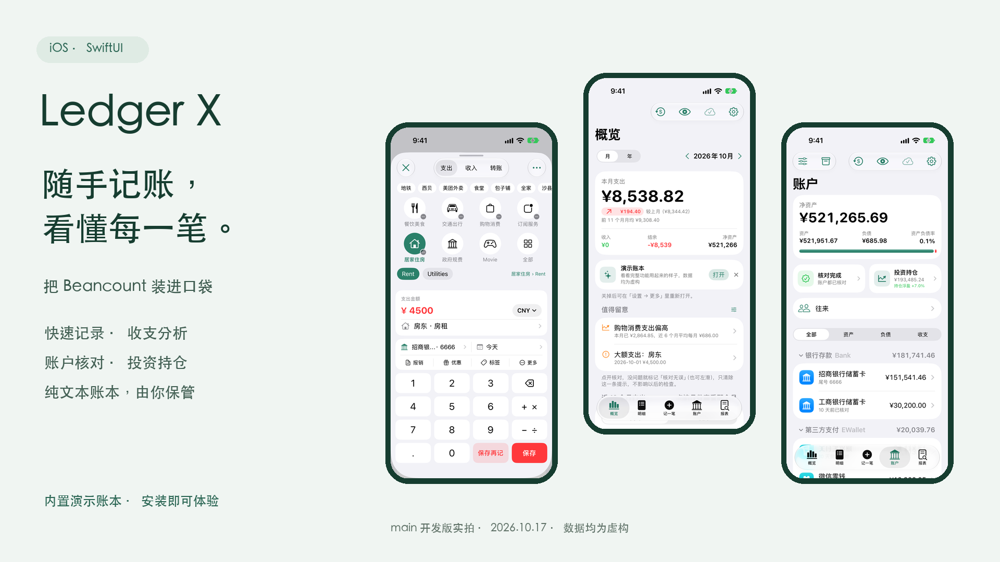
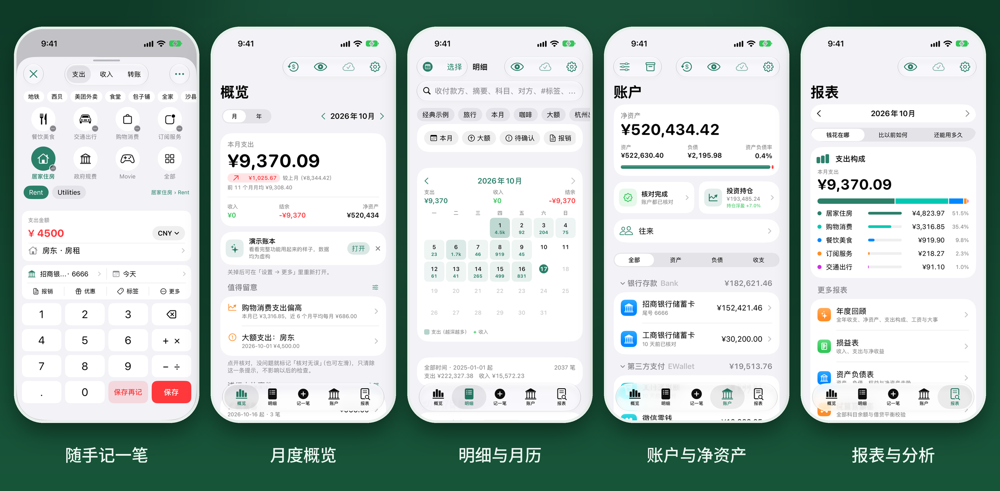

<p align="center">
  
</p>

<h1 align="center">Ledger X</h1>

<p align="center">
  <b>把 Beancount 装进口袋的原生 iOS 记账 App</b><br>
  随手记账，看懂收支；账本始终是你自己的纯文本文件
</p>

<p align="center">
  
  
  
  
  
</p>

<p align="center">
  
</p>

买完咖啡记一笔，月底看看钱花在哪，出差回来把垫付和回款对上——这些都能在手机上完成。账本仍是可读可改的 Beancount 纯文本，电脑上的 Fava、编辑器和 Git 照常使用。

## 界面一览

<p align="center">
  
</p>

## 能做什么

| | |
| --- | --- |
| ✍️ **随手记账** | 分类点选、计算器键盘；外币、换汇与手续费分开记清；草稿、复制、退款、多分录与源文本编辑 |
| 📊 **看懂变化** | 月度收支、明细搜索与月历，分类与商户统计，预算、年度回顾和现金流预测 |
| 🏦 **核对账户** | 余额核对、信用卡账单与还款、投资持仓，以及报销、备用金、个人往来和订阅 |
| 🧾 **整理资料** | 导入 CSV / XLSX 账单并查重，关联票据，本机识别付款截图后核对入账 |
| 🔐 **账本自己保管** | 本机文件夹、GitHub、GitLab、Gitea / Forgejo、WebDAV；多账本切换，离线先存，同步状态可查 |
| 🌗 **用得顺手** | 深色模式、12 种主题色、大字体、中英文、隐藏金额、面容 ID / 触控 ID、快捷指令与提醒 |

**[看图文介绍，逐项了解每个功能 →](docs/promo/introduction.md)**

## 安装

Ledger X 通过 IPA 源安装：在 SideStore、AltStore 或 Zeus 等工具里添加下面任一地址，用你自己的 Apple ID 签名（不经 App Store / TestFlight）。国内网络建议用镜像，安装包也会经镜像下载。镜像由第三方代理（gh-proxy.com）转发，信任程度低于 GitHub 直连；能直连时优先用 GitHub 地址。两种源里每个版本都带着安装包的 SHA256（与 Release 页面和发布说明里的一致），安装工具会据此核对下载的安装包。

用免费 Apple ID 签名的 App 每 7 天到期，到期后打不开。在 SideStore / AltStore 里刷新（Refresh）即可继续用，账本、草稿和设置都留在手机上，不会丢；保持刷新工具在后台自动刷新，就不用手动处理。

**开发版**：相关测试与 Xcode 检查后，编译并校验安装包发布；每次发布说明列出实际验证范围，完整回归在转正式版前完成

```text
GitHub  https://raw.githubusercontent.com/iskerwin/ledger-x/ipa/dev.json
镜像    https://gh-proxy.com/https://raw.githubusercontent.com/iskerwin/ledger-x/ipa/mirror/dev.json
```

**正式版**：开发版经过手机验收后原样发布，有正式版本后可安装

```text
GitHub  https://raw.githubusercontent.com/iskerwin/ledger-x/ipa/release.json
镜像    https://gh-proxy.com/https://raw.githubusercontent.com/iskerwin/ledger-x/ipa/mirror/release.json
```

每个版本的更新内容与验证记录见 [Releases](https://github.com/iskerwin/ledger-x/releases)。

## 先用演示账本试一遍

打开 App 选 **「先看看演示账本」**，不用注册、不用 Token、不用准备仓库，离线就能体验完整功能（数据均为虚构，修改只留在本机）。准备好记自己的账时，选 **「复制为我的空账本」** 保留账户与分类，或 **「在本机新建空账本」**，也可以连接自己的存储服务。

## 参与开发

[开发手册](docs/development/README.md) · [更新记录](CHANGELOG.md) · 问题反馈请用 [Issues](https://github.com/iskerwin/ledger-x/issues)

<sub>截图使用虚构演示数据。公开反馈时请不要上传真实账单、账号或交易编号。</sub>
