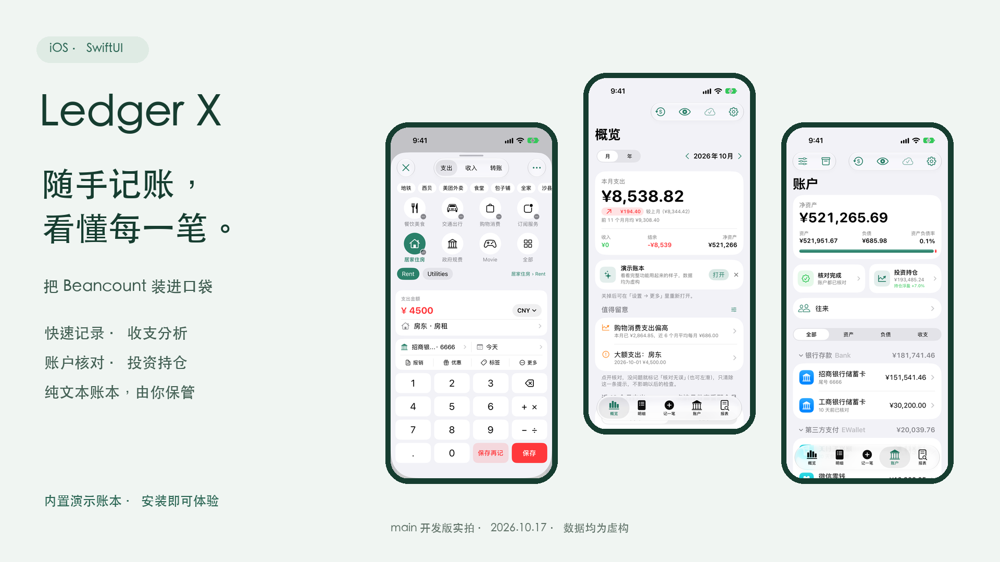
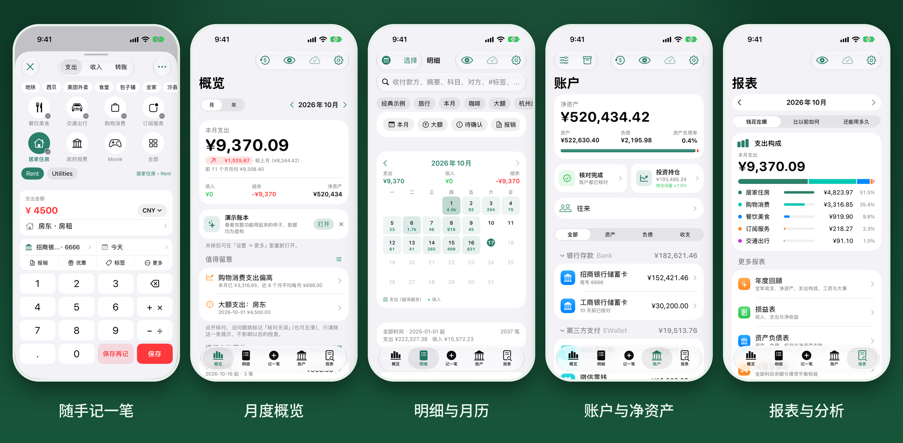
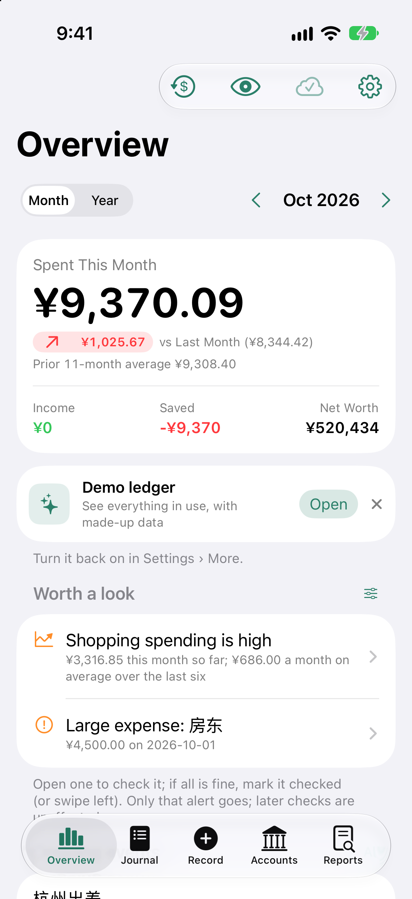

<p align="center">
  
</p>

<h1 align="center">Ledger X</h1>

<p align="center">English | <a href="README.zh-CN.md">简体中文</a></p>

<p align="center">
  <b>A native iOS app that puts Beancount in your pocket</b><br>
  Record on the go, understand where money goes; the ledger stays your own plain-text files
</p>

<p align="center">
  
  
  
  
  
</p>

<p align="center">
  
</p>

Record a coffee right after you buy it, see where the money went at the end of the month, and match the expenses you advanced on a business trip against the reimbursements, all on your phone. The ledger is still readable, editable Beancount plain text, so Fava, your editor and Git keep working on the computer.

## At a glance

<p align="center">
  
</p>

<p align="center">
  
</p>

## What it does

| | |
| --- | --- |
| ✍️ **Record quickly** | Tap a category, type on a calculator keypad; foreign currency, exchange and fees kept apart; drafts, duplicate, refunds, multi-posting entries and source-text editing |
| 📊 **See what changed** | Monthly income and spending, journal search and calendar, category and payee breakdowns, budgets, year in review and cash-flow forecast |
| 🏦 **Reconcile accounts** | Balance checks, credit card statements and payments, investment holdings, plus reimbursements, petty cash, personal IOUs and subscriptions |
| 🧾 **Keep records tidy** | Import CSV / XLSX statements with duplicate detection, attach receipts |
| 🔐 **Your ledger, your storage** | A local folder, GitHub, GitLab, Gitea / Forgejo or WebDAV; multiple ledgers, offline-first saving, visible sync state |
| 🌗 **Comfortable to use** | Dark mode, 12 accent colors, large text, English and Chinese, hidden amounts, Face ID / Touch ID, reminders |

**[A guided tour of every feature, with pictures (in Chinese) →](docs/promo/introduction.md)**

## Install

Ledger X installs from an IPA source: add either address below in SideStore, AltStore, Zeus or a similar tool, and it is signed with your own Apple ID (not through the App Store or TestFlight). From mainland China, the mirror is recommended, and the app package downloads through it too. The mirror is relayed by a third-party proxy (gh-proxy.com) and is less trustworthy than GitHub directly, so prefer the GitHub address when you can reach it. Both sources carry each version's package SHA256 (the same as on the Release page and in the release notes), and the install tool checks the download against it.

Apps signed with a free Apple ID expire after 7 days and then won't open. Refresh in SideStore / AltStore to keep using it; ledgers, drafts and settings stay on the phone and aren't lost. Keep the refresh tool refreshing in the background and you won't need to do it by hand.

**Development builds**: released once the tests relevant to the change pass. The release notes list what was actually verified. Only after a build passes on-phone acceptance is the full test suite run on the same source, and that same package promoted to a release

```text
GitHub  https://raw.githubusercontent.com/iskerwin/ledger-x/ipa/dev.json
Mirror  https://gh-proxy.com/https://raw.githubusercontent.com/iskerwin/ledger-x/ipa/mirror/dev.json
```

**Releases**: the development build package that passed on-phone acceptance, with the same version and build number

```text
GitHub  https://raw.githubusercontent.com/iskerwin/ledger-x/ipa/release.json
Mirror  https://gh-proxy.com/https://raw.githubusercontent.com/iskerwin/ledger-x/ipa/mirror/release.json
```

**Mac**: run this to install or update to the latest release (requires macOS 14 or later; the package is not notarized by Apple). Mac builds of development and preview versions are attached to their release pages

```sh
curl -fL https://github.com/iskerwin/ledger-x/releases/download/mac/LedgerMac.zip -o /tmp/LedgerMac.zip && ditto -x -k /tmp/LedgerMac.zip /Applications && open "/Applications/Ledger X.app"
```

What changed in each version, and how it was verified, is in [Releases](https://github.com/iskerwin/ledger-x/releases).

## Try the demo ledger first

Open the app and choose **Try the demo ledger**: no sign-up, no token and no repository needed, and every feature works offline (all data is made up, and changes stay on the device). When you're ready for your own books, choose **Copy as my empty ledger** to keep the accounts and categories, or **New empty ledger on this phone**, or connect your own storage.

## Contributing

[Developer handbook (Chinese)](docs/development/README.md) · [Changelog](CHANGELOG.md) · Report problems in [Issues](https://github.com/iskerwin/ledger-x/issues)

Before opening a PR, read the handbook's [02 Bookkeeping and data rules](docs/development/02-记账与数据规范.md), [03 Architecture](docs/development/03-技术架构与代码导航.md) and [04 Cloud testing and release](docs/development/04-云端测试与发布.md). One change per PR; run `python3 tools/ship.py check` locally, and before merging, "Ledger CI / gate" must pass with the branch up to date with main; show interface or interaction changes in a preview build first. The PR template lists what's required for the CHANGELOG, English strings, the in-app guide and the on-phone acceptance checklist. Use made-up data only; never commit real statements or accounts.

<sub>Screenshots use made-up demo data. When giving feedback in public, please don't upload real statements, accounts or transaction numbers.</sub>
