<p align="center">
  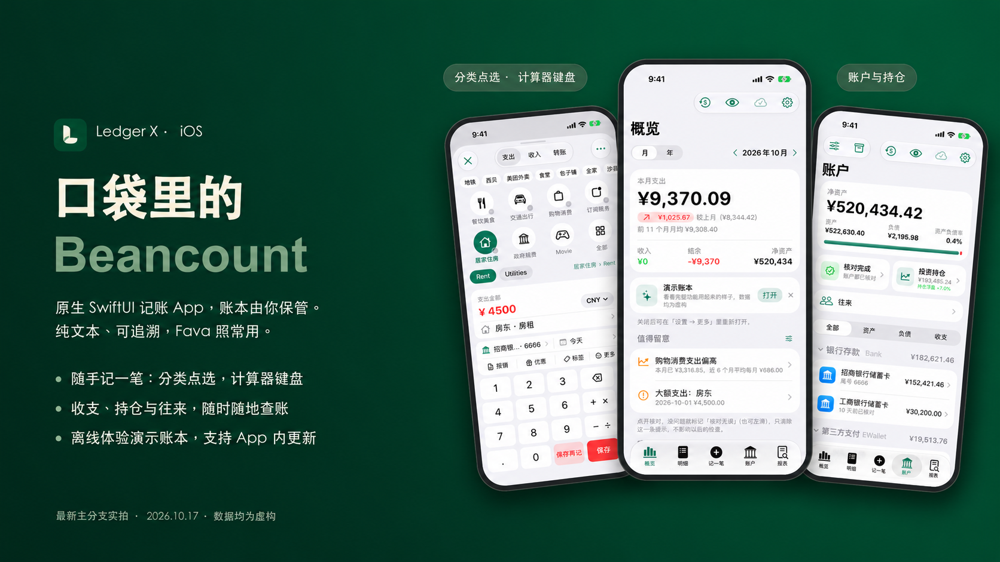
</p>

<h1 align="center">Ledger X</h1>

<p align="center">
  把 Beancount 装进口袋的原生 iOS App<br>
  随手记账，看懂收支；账本仍是你自己的纯文本文件
</p>

<p align="center">
  <a href="../../releases"></a>
  
  
  
</p>

> **当前发布版 0.2.0.1（预览版）。** 下方截图实拍于 2026-10-17 的 main 开发版，包含尚未发布的 0.2.1 界面改进；发布版与开发版的区别见 [CHANGELOG](CHANGELOG.md)。
>
> 想先看看实际体验？读 [Ledger X 图文介绍](docs/promo/introduction.md)，或安装后直接打开内置演示账本。

---

## 为什么做它

买完咖啡就记一笔，月底随手看看钱花在哪，出差回来把垫付和回款对上。Ledger X 让这些事在 iPhone 上完成，同时保留 Beancount 纯文本账本的自由：电脑上的 Fava、编辑器和 Git 工作流可以继续使用。

- **账本仍是纯文本。** App 直接读写仓库里的 `.bean` 文件，写入格式与手写一致（金额右对齐、按日期插入到正确位置）。电脑上 `git pull` 后，Fava、bean-check、编辑器照常使用。
- **账本由你保管。** 不需要 Ledger X 账号，可用本机文件夹或自己的仓库存储账本；仓库 Token 存在 iOS 钥匙串里。
- **原生、离线可用。** 解析器用 Swift 实现，在本机处理账本；没网时记的账先保存在本机，待同步状态和失败原因都能查看。
- **改账前先检查。** 每次提交前在本机检查借贷、账户和余额断言等问题；不支持的插件会列出，服务端 bean-check 仍可作为补充验证。

## 功能

### 记账：几秒钟记完一笔

<p>
  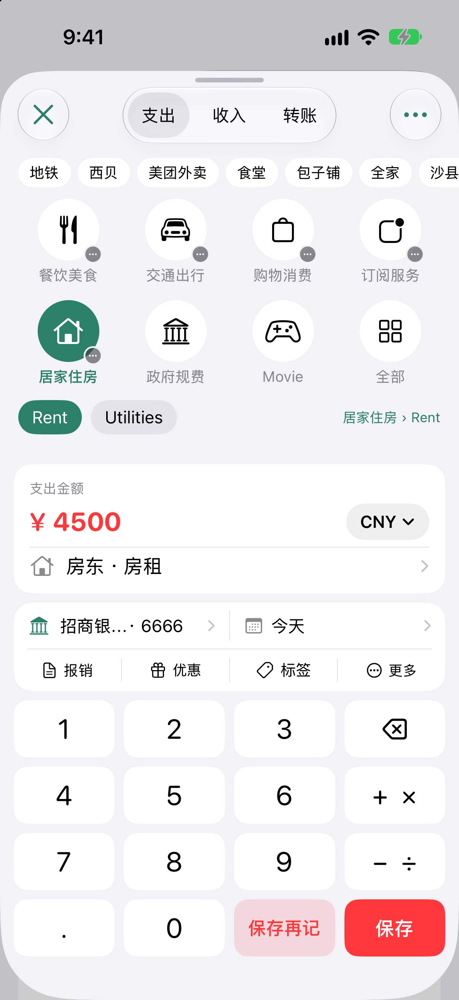
  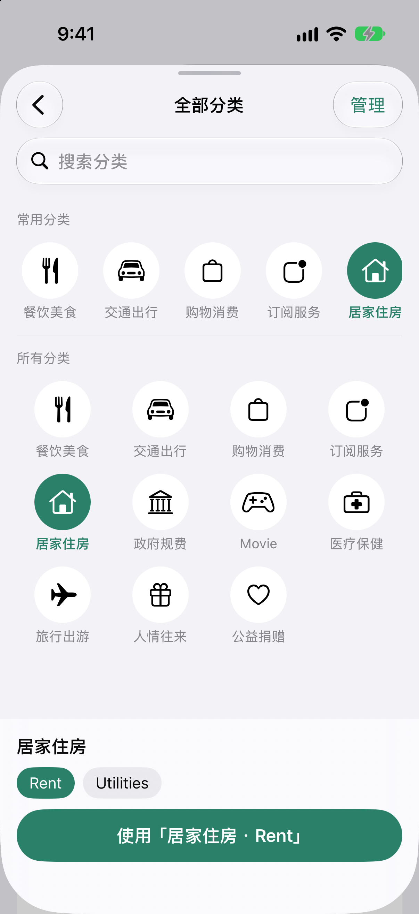
  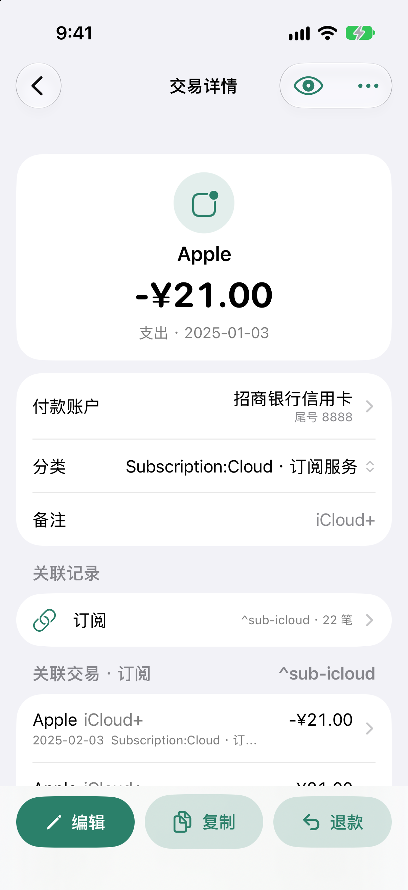
</p>

- 任何页面点底部的「记一笔」弹出记账卡片：常用分类固定两行，选中后可在下方切换子类，「全部」里搜索更多分类；自带计算器键盘，「保存再记」连续记，记完回到原页面
- 支出、收入、转账在卡片上完成；退款、多分录、AA、直接写 Beancount 文本在「完整表单」
- **常用交易**：从近期记录找出重复交易，固定金额的一键入账
- 输入收付款方即联想，带出上次的科目和付款账户；金额支持算式（`23.5+12×2`）、外币实付、跨币种转账
- 底部实时生成 Beancount 文本，点按可全屏手改；保存后提示条显示相关账户的最新余额，可一键撤销
- **提交前检查**：新造成的余额断言失败、借贷不平、未开户科目、余额变负、超出信用额度都会拦下，可返回修改、仍然提交或暂存本机
- **截图记账**：快捷指令传入微信 / 支付宝的付款截图，本机识别文字后填好金额、日期、收付款方、付款卡、科目和订单号；外币卡照截图写汇率，退款自动关联原交易。截图读完即丢弃，不保存、不上传
- **可视化编辑**：已有的交易用同一张卡片打开，改完保存即替换原交易
- **导入账单**：支付宝、微信、银行 CSV / Excel，自动匹配科目与付款账户，标出已记过的交易

### 概览：一眼看清这个月

<p>
  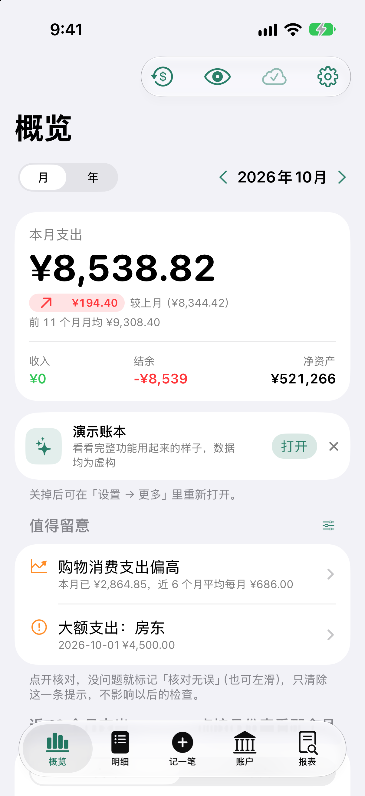
  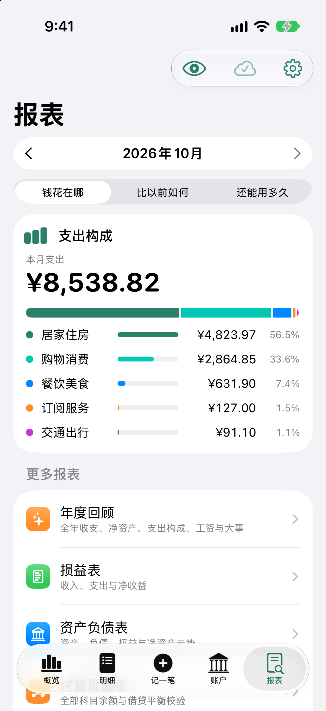
  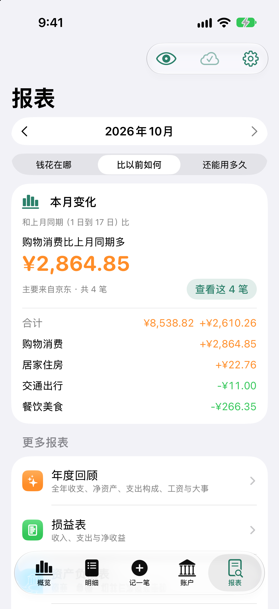
</p>

- 本月 / 本年支出与环比、收入、结余、储蓄率、净资产
- 近 12 个月图表，「支出」和「收支」两种视图，点按月份联动下方
- **支出构成**：比例条加排行，显示和上月相比多花或少花了多少，点按展开子分类
- **商户排行**：按金额或按次数，附次数与平均每次金额
- **负债**：每张卡的额度使用进度、本期应还和到期日
- 信用卡待还、现金流预测、订阅、预算、待报销垫款都在这一页；喜欢环形图可在设置里切回

### 交易、链接与账本检查

<p>
  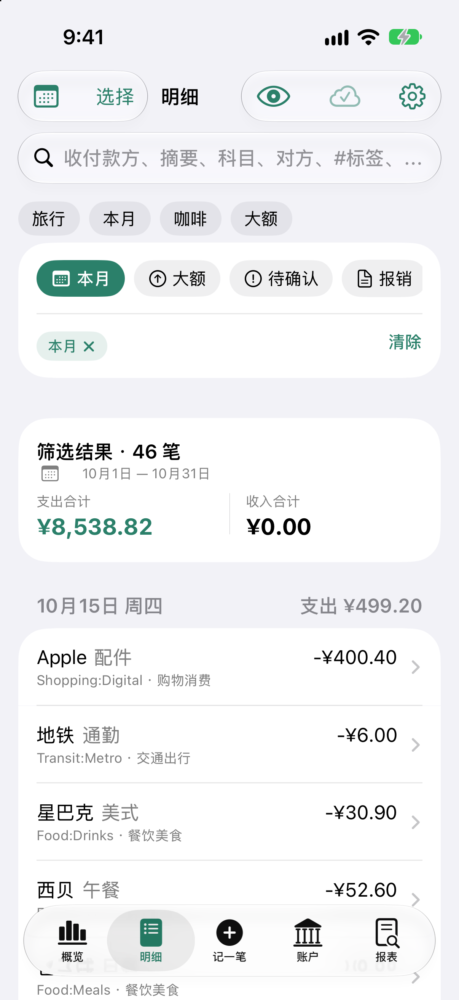
  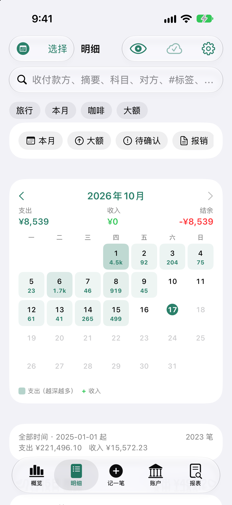
  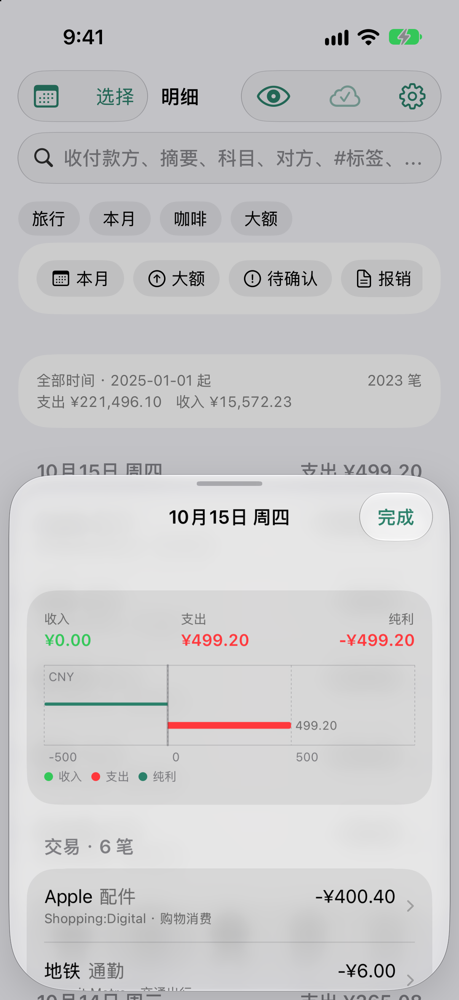
</p>

- 明细组合搜索：收付款方、摘要、科目、`#tag`、`^link`、`>100`、`2026-09`、`本月`、`近 30 天`，`|` 表示任一；常用的存成**快速搜索**，一点即搜
- **日历**：在明细列表上方展开月历，点某天弹出当天收入、支出、纯利、分币种图表与交易，列表仍保留
- 交易详情可编辑源文本、删除、复制为新交易、登记退款、加入订阅
- **链接**：点开即可看到同一链接下的全部交易，按退款 / 报销 / 订阅分组，显示原价、已退、净支出或垫付、回款、待回款
- **链接检查**：链接只剩一笔、找不到原交易或垫付、金额对不上、科目不一致、退款没有关联……在详情页直接修复，提交前有确认页
- 新链接统一命名为「用途-商户拼音-日期」，如 `refund-taobao-20260902`、`reimburse-liangfan-20250831`
- **账本检查**：Beancount 错误、余额断言、链接问题、bean-check 结果集中在一页，问题可点开对应交易处理
- **报销**：勾选垫付的交易，填回款金额，自动生成入账交易并关联

### 账户与余额核对

<p>
  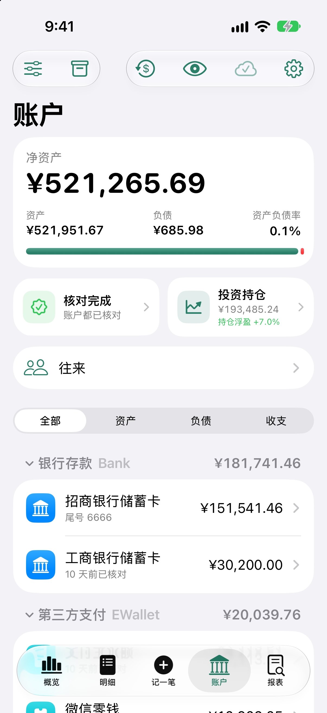
  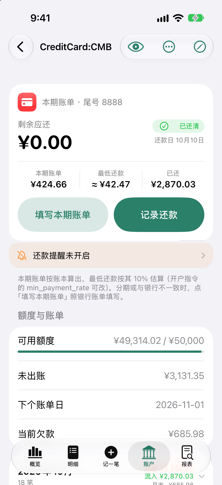
  
</p>

- 账户按类型分组，带净资产与资产负债率；账户可在账本里用 `name:` 写中文名
- 账户明细带滚动余额，余额断言一目了然；**余额核对** 输入银行 App 里的余额，自动生成 `balance` 断言
- **账单日 / 核对日**：为账户设置后，每月这一天提醒对照银行余额，一致后写入当天的余额断言
- **管理账户**：新建、改开户信息、关闭，跨文件重命名与合并科目
- **信用卡账单**：设置账单日、还款日（`statement_day` / `due_day`）后显示本期应还、已还、未出账和可用额度，一键记录还款，到期前提醒
- **投资持仓**：市值、成本、浮动盈亏与每一批次；证券和汇率价格自动获取

### 报表、订阅与查询

<p>
  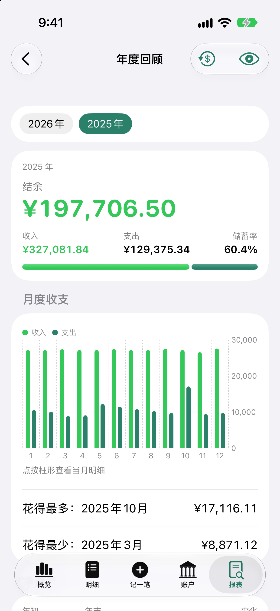
  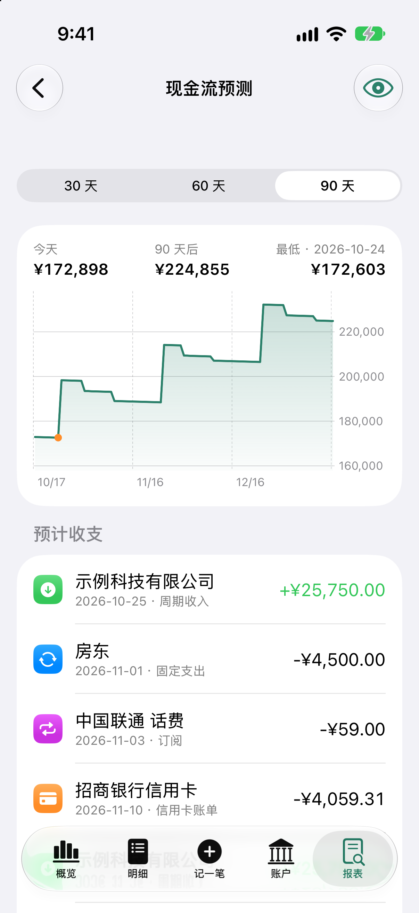
  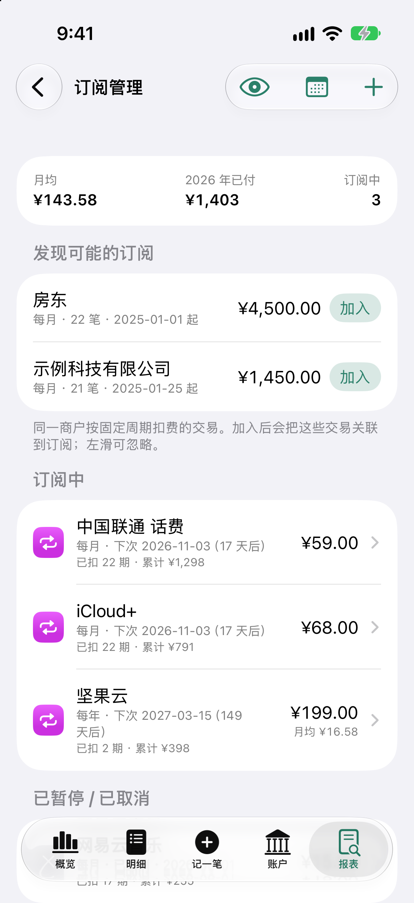
  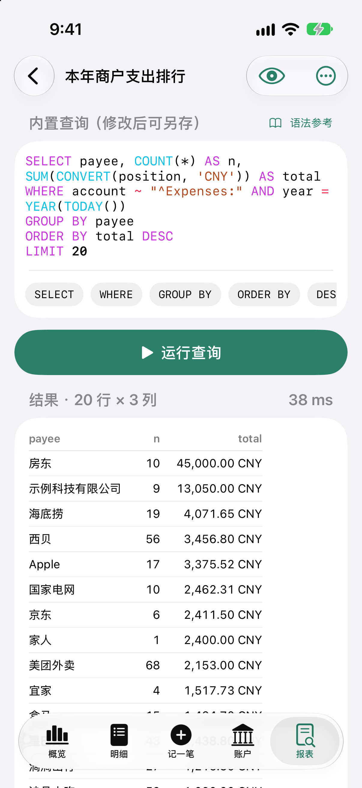
</p>

- **报表首页**先回答「钱花在哪」「比以前如何」「还能用多久」，从分类变化直接追到具体交易
- **年度回顾**：一年收支、储蓄率、净资产走势、支出构成，以及工资、订阅、报销等汇总
- **损益表 / 资产负债表 / 试算平衡表 / 预算**（Fava 同款 `custom "budget"`）
- **现金流预测**：根据工资、固定支出、订阅、信用卡账单和日常消费，推算未来 30～90 天可用资金，余额可能不足时提醒
- **订阅管理**：周期扣费写成 `custom "subscription"`，扣费交易用 `^sub-…` 关联；调价、暂停、取消都保留历史；自动发现周期性扣费；到期提醒、一键入账、订阅日历
- **BQL 查询**：`SELECT … WHERE … GROUP BY … ORDER BY … LIMIT`、`BALANCES`、`JOURNAL`；内置常用查询，「我的查询」保存在账本的 `queries/custom.bql`，所有设备同步；结果可导出 CSV

### 设置与安全

<p>
  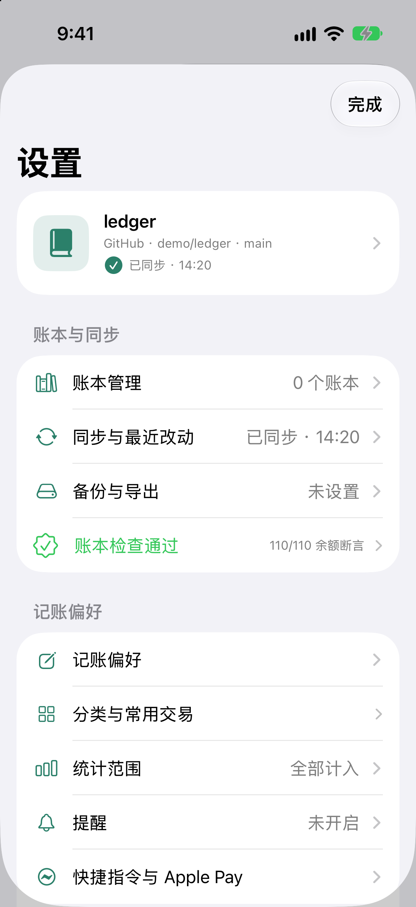
  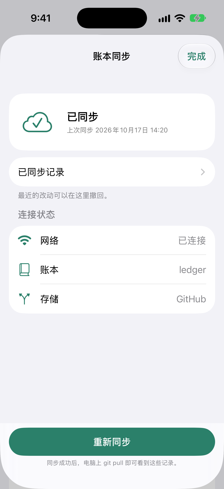
  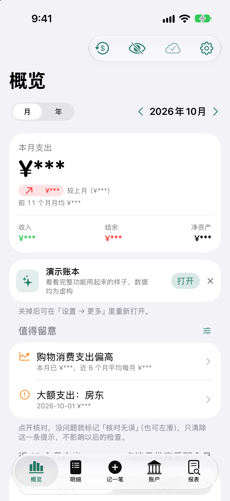
  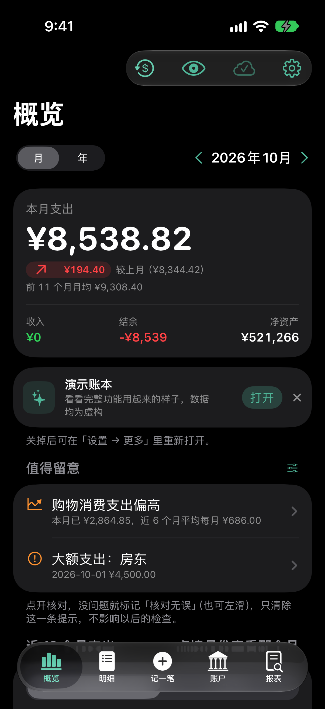
</p>

- **多个账本**：GitHub、GitLab、Gitea / Forgejo、「文件」App 里的文件夹、WebDAV，随时切换
- **仓库结构**：保存在账本的 `ledger-x.json` 里，所有设备共用——按类型指定写入哪个文件（`{year}`、`{month}`、`{root}`）、按科目把交易分流到单独的文件、按规则一次整理已有记录
- **隐藏金额**：所有金额显示为 `¥***`，适合在人前打开
- 面容 ID / 触控 ID 锁定；12 种主题色，浅色 / 深色；**简体中文 / English**
- **最近改动**：查看本机做过的每次修改并撤回；**源文件**：直接查看和编辑仓库里的账本文件，Beancount / BQL 语法高亮，8 种代码配色，键盘上方的快捷栏插入日期、新交易、账户和对齐当前这笔
- **往来**：报销应收、公司往来和每个人的借还款、AA 分摊集中在一页，按人看净额，借出 / 收回 / 借入 / 还钱一步记账，确定不会再变的差额一键结清
- **事件**：出差、旅行等写成事件，进行中时新记录自动带上 #标签，按事件汇总花费和未报销垫款
- **工资**：按工资条逐项记工资（模板存在 ledger-x.json），少发、未发的补贴挂公司往来，按年汇总
- **值得留意**：重复记录、大额支出、分类超常、订阅调价，点开核对后标记「核对无误」
- **备份与导出**：每周自动把整个账本打包备份到 iCloud Drive 等文件夹，保留最近 12 份；导出交易明细 CSV
- 默认币种、本地提醒、快捷指令与 Apple Pay 自动记账、票据附件、批量编辑、iPad 分栏布局

## 快速体验：打开内置演示账本

安装后点「先看看演示账本」，就能查看虚构的收支、账户、投资与报销数据，也可以随意记账和修改，随时重置。无需注册、Fork 仓库或创建 Token。

准备开始自己的账本时，点「复制为我的空账本」，或在连接页点「在本机新建空账本」：保留常用账户与分类，不带入演示交易，之后也可以迁移到 Git 仓库。

### 安装与连接 GitHub 演示仓库

希望体验 Git 同步时，可以使用独立的 [ledger-demo](https://github.com/iskerwin/ledger-demo) 仓库，按下面步骤连接自己的 Fork。

1. **安装 App**：在 [SideStore](https://sidestore.io) 或 AltStore 的「源」里添加下面任一地址，之后在源里安装，有新版本时直接显示更新：
   - 发布版：`https://ledger.iskerwin.com/release.json`
   - 开发版（main 最新构建，也包含发布版）：`https://ledger.iskerwin.com/dev.json`

   两个源是同一个 App，添加一个即可。这两个地址是 Cloudflare 上的镜像（[`tools/cloudflare/worker.js`](tools/cloudflare/worker.js)），源和安装包都从 Cloudflare 下载，国内更快；GitHub 上的原始地址 `https://raw.githubusercontent.com/iskerwin/ledger-x/sidestore/release.json`（或 `dev.json`）内容相同，添加后刷新一次也会改用镜像。自己部署镜像时，把仓库变量 `SIDESTORE_MIRROR` 设为镜像地址即可。也可以在 [Releases](../../releases) 下载 `Ledger.ipa` 手动导入（免费 Apple ID 签名 7 天有效，SideStore 会自动续签）。
2. **Fork 演示账本**：打开 [iskerwin/ledger-demo](https://github.com/iskerwin/ledger-demo)，点右上角 **Fork**。
3. **创建 Token**：GitHub → Settings → Developer settings → **Fine-grained tokens** → Generate new token

   | 设置 | 值 |
   | --- | --- |
   | Repository access | Only select repositories → 你 fork 的 `ledger-demo` |
   | Contents | **Read and write** |
   | Actions（可选） | Read-only，用来显示 bean-check 结果 |

4. **连接**：打开 App，填写 GitHub 用户名、仓库 `ledger-demo`、分支 `main` 和 Token，点「连接」。

在 App 里记的每一笔都会成为 fork 仓库里的一次提交。想恢复初始数据，在 GitHub 上对 fork 执行 Sync fork（丢弃改动）即可。

## 使用自己的账本

在「设置 → 账本 → 添加账本」连接，可同时保存多个：

| 存储位置 | 说明 |
| --- | --- |
| GitHub | fine-grained token，Contents 读写；每次保存是一次提交，可显示 bean-check 结果 |
| GitLab | gitlab.com 或自建，Personal / Project access token（api 权限） |
| Gitea / Forgejo | 自建或 Codeberg，应用令牌（repository 读写） |
| 文件夹 | 「文件」App 里的任意文件夹：iCloud Drive、坚果云、OneDrive，或 Working Copy 管理的本地 Git 仓库 |
| WebDAV | 坚果云、Nextcloud、群晖等 |

App 读取主文件（默认 `main.bean`）及其 `include` 的全部文件，不需要改动你的仓库结构：

| 写入的内容 | 默认位置 |
| --- | --- |
| 交易 | 最近一年交易所在的文件，如 `journals/2026.bean`；跨年时自动新建并在主文件中加 `include` |
| 余额断言、价格、开户 / 关户等 | 账本里放同类指令最多的文件 |
| 订阅 | `subscriptions.bean` |
| 我的查询 | `queries/custom.bql` |

想换位置，在「设置 → 仓库结构 → 文件规则」里改，保存后写入仓库根目录的 `ledger-x.json`：

```json
{
  "files": { "accounts": "accounts/{root}.bean", "subscriptions": "subscriptions.bean" },
  "rules": [{ "account": "Assets:Invest", "file": "investments/{year}.bean" }],
  "slugs": { "岭南通 羊城通": "yangchengtong" }
}
```

`slugs` 用来指定链接里的商户拼音（多音字、简称）。

## 开发与发布

| 操作 | 结果 |
| --- | --- |
| 推送到 `main` | 跑测试 → 编译 → 更新开发版 **dev**（`Ledger.ipa`、测试日志、模拟器截图），版本号为「最新发布版.构建号」 |
| 在 Actions 里运行 iOS 工作流并填写版本号，或推送 `v*` 标签 | 跑测试 → 编译 → 发布该版本；`0.x` 发布为预览版；更新说明取自 [CHANGELOG.md](CHANGELOG.md) 里对应版本的段落 |

发布新版本前，先在 `CHANGELOG.md` 顶部加上这一版的「新功能 / 改进 / 修复」。

- `LedgerKit/` — Beancount 解析、记账、格式化、BQL 引擎与报表（Swift Package，无 UI，可单独 `swift test`）
- `Ledger/` — App（SwiftUI，iOS 17+）。界面文字以中文为键，英文翻译在 `Ledger/en.json`
- `project.yml` — XcodeGen 工程：`brew install xcodegen && xcodegen` 后用 Xcode 打开
- `tools/golden.mjs` — 用 `tools/reference/` 里的 JavaScript 参考实现生成测试账本和标准答案，Swift 解析结果须与之逐项一致

截图中的数据均来自 App 内置的虚构演示账本。原始截图位于 [docs/screenshots/latest](docs/screenshots/latest)，拍摄来源见 [capture.json](docs/screenshots/latest/capture.json)；构建并安装模拟器 App 后，可运行 `python3 tools/capture-promo.py <模拟器 UDID>` 重新拍摄。
