# Ledger X：把自己的账本，随身带在 iPhone 上

买完咖啡随手记一笔，月底看清钱花在哪；信用卡还要还多少、出差垫付有没有到账，也能在手机上查明白。Ledger X 把 Beancount 的记账、账户和报表带到 iPhone，让日常记录更顺手，让账本继续由你保管。

原生 SwiftUI 界面，账本仍是可读、可编辑的纯文本文件。可以从本机空账本开始，也可以连接自己的仓库，和电脑上的 Fava、编辑器接着用。不需要注册 Ledger X 账号。

## 记一笔，金额、分类和付款账户都在手边

点底部「记一笔」，直接选择常用分类和子分类，用计算器键盘输入金额。商户、说明、付款账户和日期都可以补充；连续补记时，点「保存再记」即可继续。

  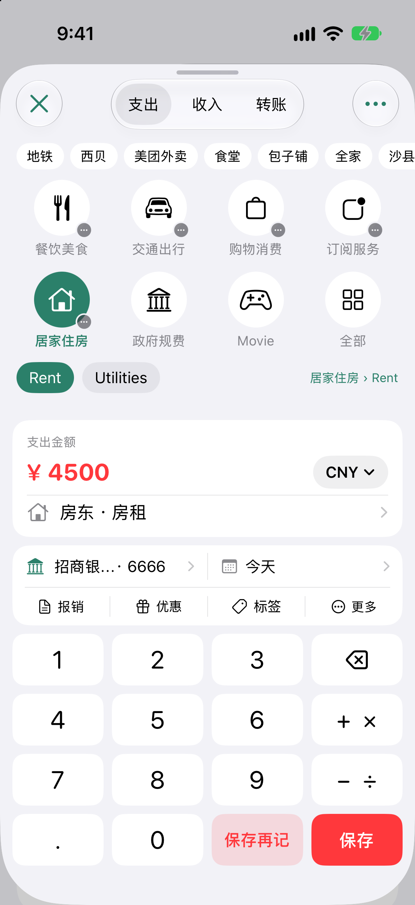
  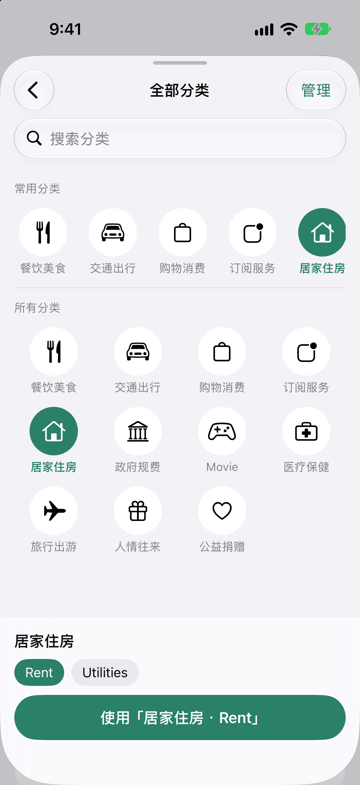
  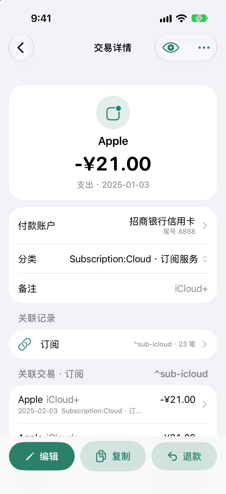

一张小票里既有食材又有日用品，可以拆到不同分类；一笔消费由两张卡或钱包共同付款，也可以保留在同一条记录里。报销垫付、优惠、标签、AA 分摊和退款有对应入口，复杂交易仍能查看完整分录。

记好的记录可以编辑、复制或登记退款，也能打开源文本核对。快捷记账、完整表单、分录和文本共用编辑内容；无法完整转换的交易会保留原内容并提示，不替你猜测。保存前检查账户、交易平衡和余额断言等问题，最近改动支持撤回。

## 外币、换汇和手续费，分别记清楚

外币消费可以同时记录账单币种与实际扣款币种。转账和换汇可以选择目标币种、切换报价方向，保留银行的报价写法；同一账户内不同币种的兑换也能记录。

手续费单独列示：本金外另扣、转出金额已含费用、从兑换所得中扣除，或由其他账户/币种单独支付，按实际情况选择。普通支出的商品金额与费用也分开记录，核对本金、手续费和最终扣款时更清楚。

金额、报价和币种在同一个面板核对，完成后应用，取消则保留原来的输入。保存后仍可查看分录与账本文本。

## 从“花了多少”，看到“为什么变多”

概览把月度收支、结余、净资产和趋势放在一起。点按图表中的月份，再继续查看对应明细。

  
  
  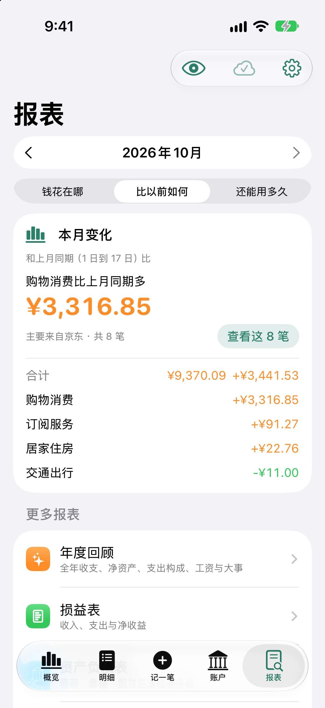

报表围绕「钱花在哪」「比以前如何」「还能用多久」展开。某类支出比上月多，就继续追到具体交易；分类超常、大额支出、重复记录和订阅调价，也能从「值得留意」逐项核对。

## 明细按条件找，月历按日回看

明细提供快捷筛选，显示结果笔数、收支合计和统计范围。商户、科目、标签、日期或金额条件可以组合搜索，常用的条件还可以保存下来。

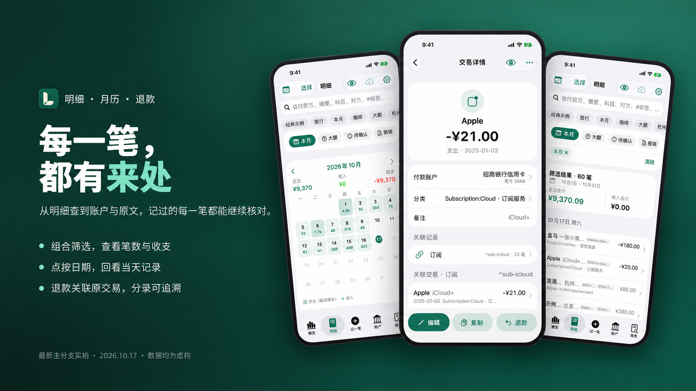

  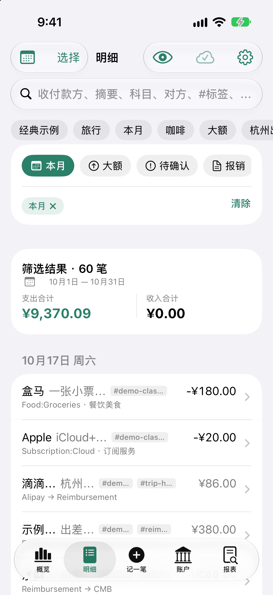
  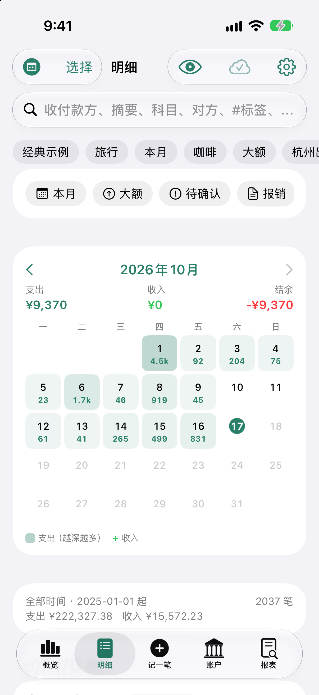
  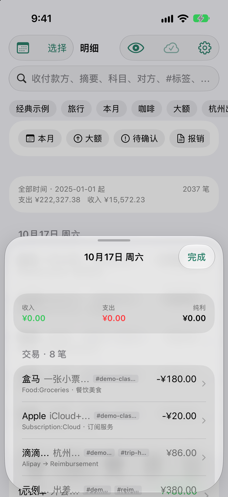

月历在明细列表上方展开，下面的交易仍然保留。点某一天，打开当天窗口查看收支、分币种图表、交易与票据。账户、预算和报表也能直接跳转到相关记录，少一点来回翻找。

## 账户、信用卡和投资，一起看清

银行卡、现金、支付钱包、信用卡与投资账户，都能在账户页查看。余额核对时输入银行 App 中的实际余额，先看差额，再确认是否写入余额断言；账户流水显示滚动余额，方便逐笔检查。

  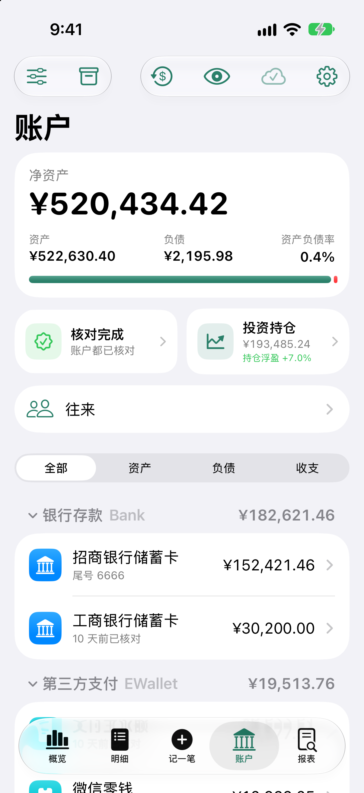
  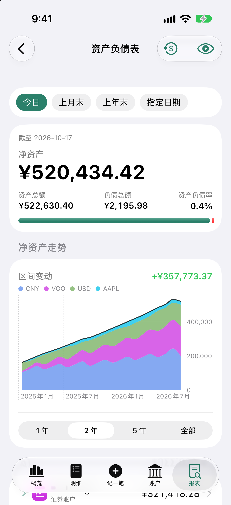
  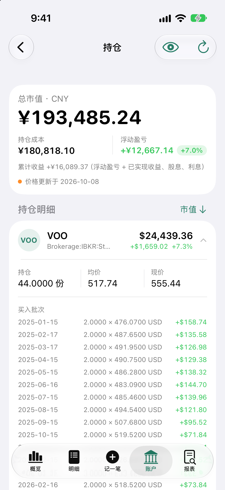

信用卡支持账单周期、剩余应还、到期提示和记录还款，也可以照银行账单填写本期应还与最低还款。手填与估算分别标明，具体金额以银行账单为准。

持仓展示市值、成本、浮动盈亏、价格日期和买入批次，支持按市场筛选与排序，继续追溯到账户流水和对应记录。

## 报销、AA、工资和订阅，各有来往

出差垫付、公司备用金、工资少发或补发、朋友借还款与聚餐 AA，都能按对应往来查看。个人往来按人看净额，报销可以关联多笔垫款与分批回款。

  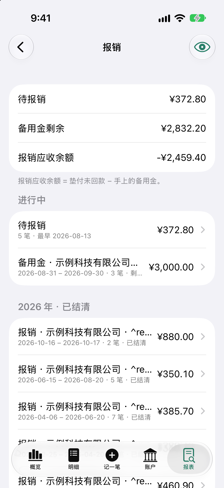
  
  

订阅管理保留调价、暂停与取消的历史，支持到期提醒、订阅日历和一键入账。工资可按工资条逐项记录；旅行和出差可以按事件汇总花费与未报销垫款。

预算显示分类额度与执行进度。现金流预测结合已记录的工资、订阅、信用卡账单和日常消费，估算未来的可用资金，方便提前安排；预测会随账本内容变化，不替代实际账户余额。

## 熟悉的报表，也能继续自己查

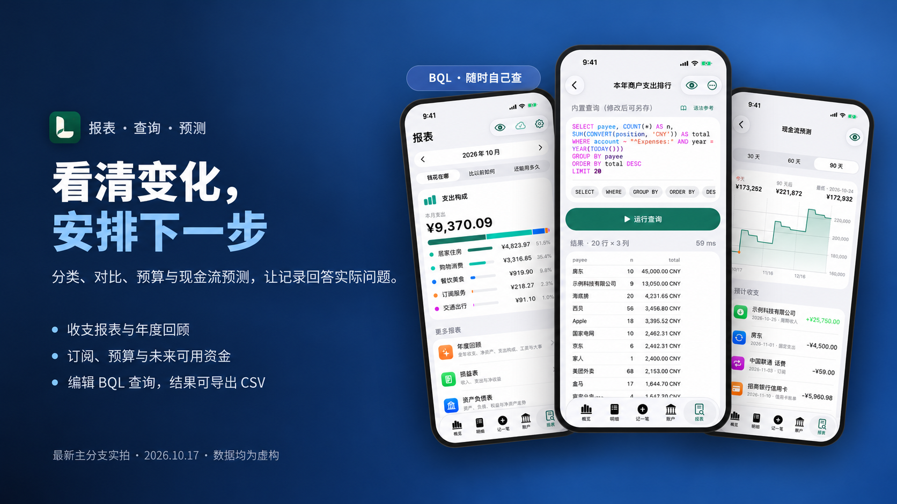

  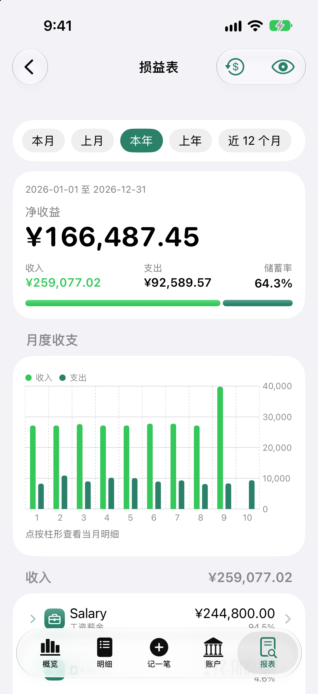
  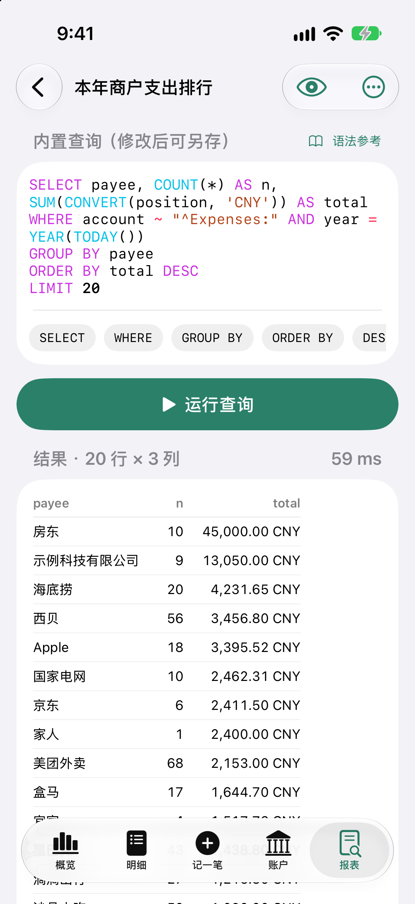
  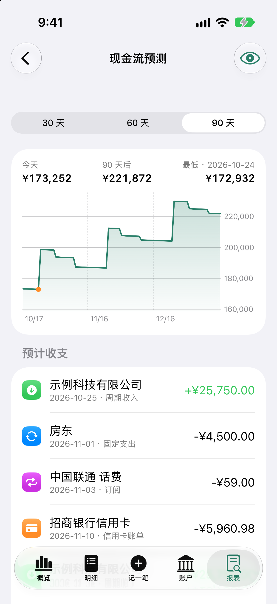

损益表、资产负债表、试算平衡表和年度回顾，可从日常记录一路看到整年的收支与净资产变化。熟悉 Beancount 的用户可以编辑查询、运行账本中的查询并导出 CSV；「我的查询」保存在账本中，随账本同步。

App 支持常用 BQL 子集。未支持的插件会列出，官方 bean-check 可继续作为补充检查，电脑端工具也能沿用。

## 账本自己保管，资料也能整理

账本可以保存在本机或「文件」App 的文件夹，也可以连接 GitHub、GitLab、Gitea / Forgejo、WebDAV。使用 Git 仓库时，手机修改成为提交，电脑拉取后可以继续编辑。离线先保存在本机，之后从「账本同步」查看远端写入结果与失败原因。

CSV / XLSX 账单可以核对列映射、分类和付款账户，先查重再导入；中途关闭后可继续处理进度。拍照或选择票据文件后，先确认保存位置与文件名，再上传并关联。上传失败保留本机恢复副本，重试沿用同一路径。

付款截图通过本机文字识别预填交易，由你核对后入账。识别与主动上传票据是不同操作，不能把识别截图当作已经保存的附件。账本文本可以备份与导出；票据文件需要另外妥善保管。

## 按自己的习惯，安心记账

  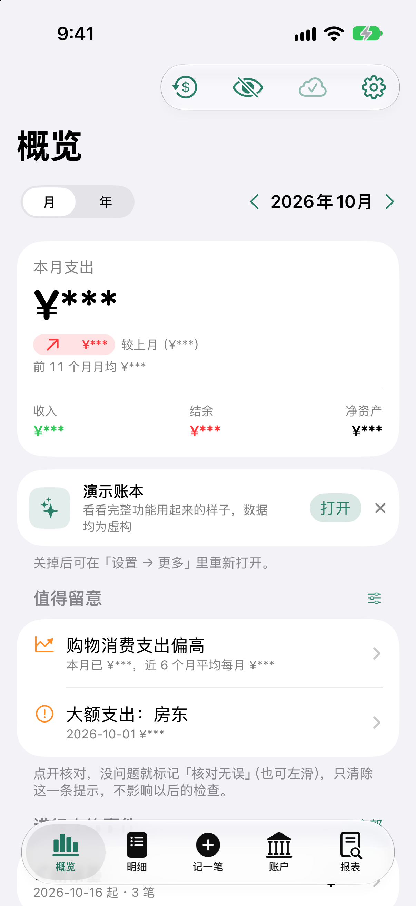
  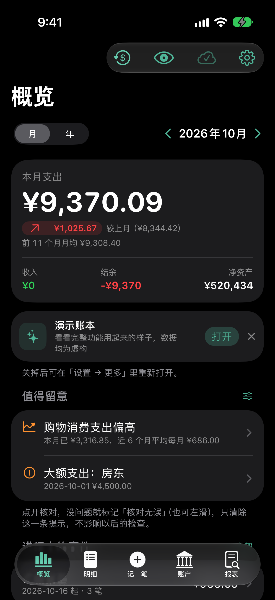
  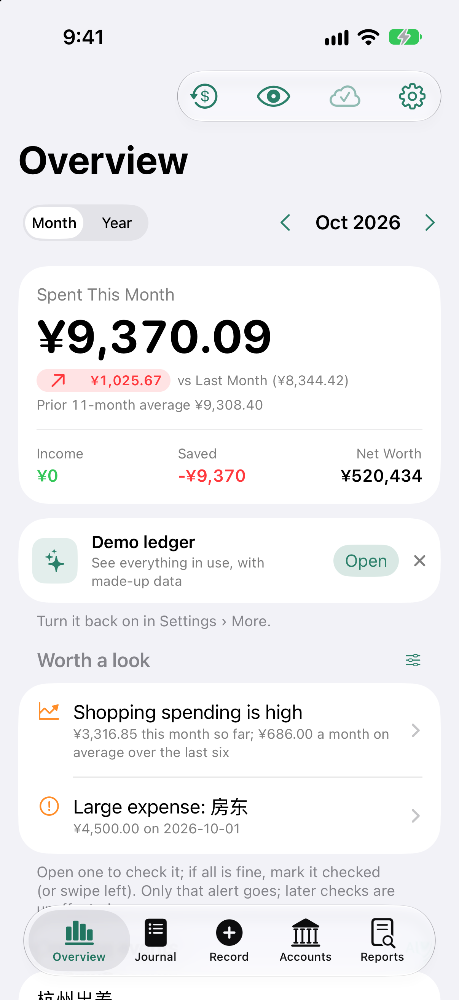

主题色、深浅色外观、简体中文与 English 可以按习惯设置。面容 ID / 触控 ID 锁定、切入后台的隐私遮挡和隐藏金额，适合不同的查账场合。仓库凭据保存在系统钥匙串。

支持大字体、VoiceOver、触感设置和系统减少动态效果；iPad 使用适合宽屏的侧栏布局。

## 先用演示账本试一遍

点「先看看演示账本」即可打开，无需注册、Fork 仓库或创建 Token。App 内置虚构账本，可离线体验；演示中的修改只保存在本机，不会写回公共仓库。

你可以先试着记一笔消费，复制或修改这笔记录，再回到明细、账户和报表查看结果；接着体验分类拆分、退款、分批报销、订阅和预算。演示数据有更新时可以在 App 内下载，重置或更新前请留意清除本机演示修改的提示。

准备开始自己的账本时，点「复制为我的空账本」，或在连接页选择「在本机新建空账本」：保留账户与分类，不带入演示交易，也可以随后连接自己的仓库。安装方法见 [首页](../../README.md#安装)。

---

配图使用虚构演示数据，界面细节以实际安装版本为准。支持 iOS 17 及以上的 iPhone 与 iPad。

[返回首页](../../README.md) · [开发手册](../development/README.md) · 反馈问题请使用本项目仓库的 Issues
