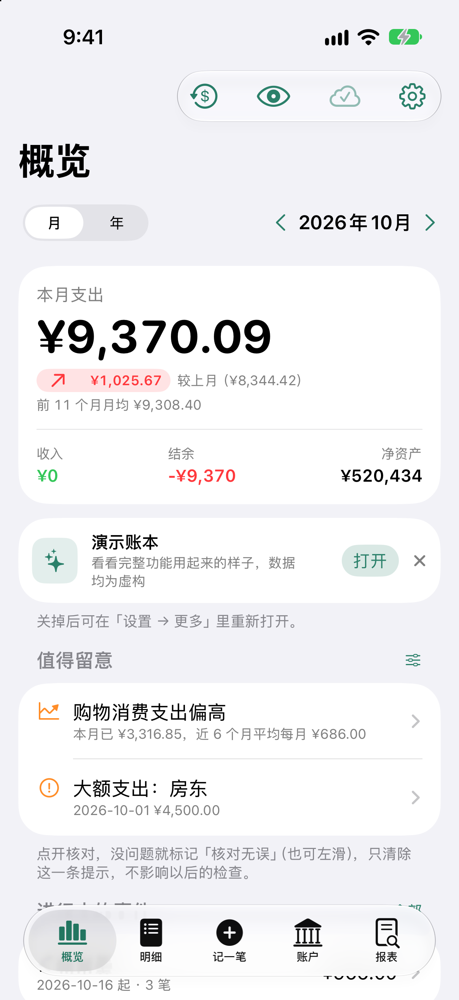
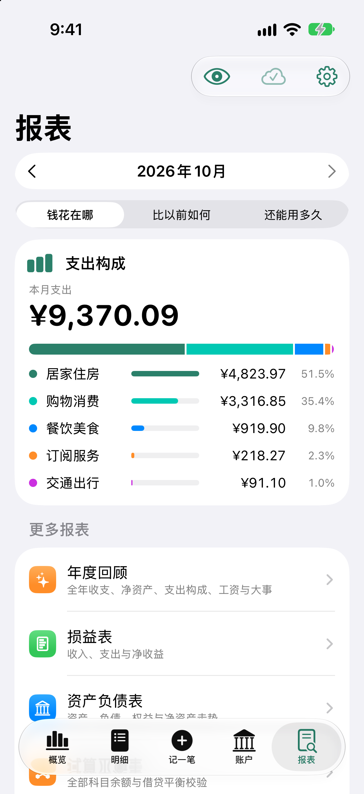
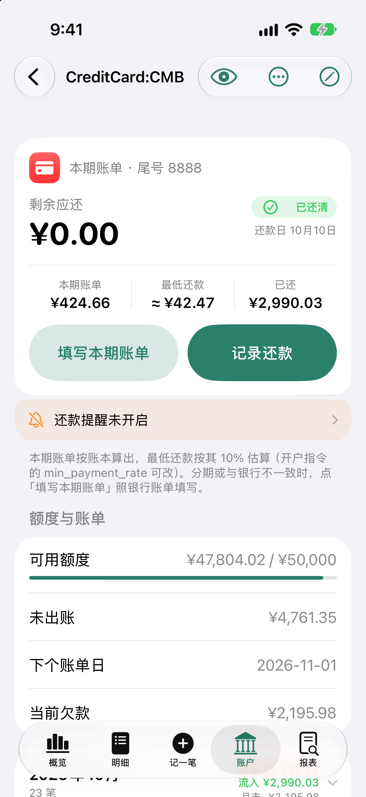
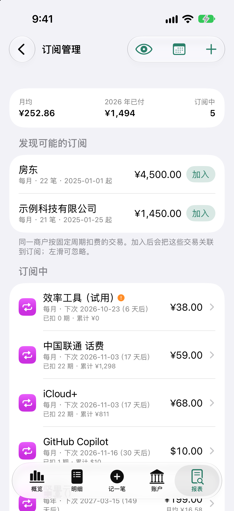
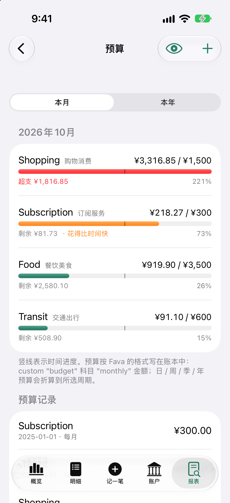
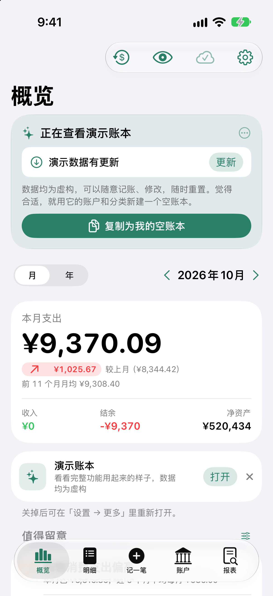

# Ledger X：把自己的账本，随身带在 iPhone 上

买完咖啡随手记一笔，月底看清钱花在哪；信用卡还要还多少、出差垫付有没有到账，也能在手机上查明白。Ledger X 把 Beancount 的记账、账户和报表带到 iPhone，让日常记录更顺手，也让账本继续由你保管。

原生 SwiftUI 界面，账本仍是可读、可编辑的纯文本文件。可以从本机空账本开始，也可以连接自己的仓库，和电脑上的 Fava、编辑器接着用。不需要 Ledger X 账号。

## 记一笔，金额、分类和付款账户都在手边

点底部「记一笔」，直接选择常用分类和子分类，用计算器键盘输入金额。商户、备注、付款账户和日期都可以补充；连续补记时，点「保存再记」即可继续。

  
  
  

一张小票里既有食材又有日用品，可以拆到不同分类；一笔消费由两张卡或钱包共同付款，也可以放在同一条记录里。报销、优惠、标签、AA 分摊和退款有对应入口，复杂的交易也能保留完整分录。

已经记好的记录，打开详情就能编辑、复制或登记退款；分类可以直接修改。需要核对细节时，还能展开分录与源文本，修改后也可以从「最近改动」中撤回。

也可以导入支付宝 / 微信账单，逐笔处理待确认项；通过快捷指令传入付款截图时，App 会在本机识别并预填金额、商户、账户等信息。用于识别的截图读完即丢弃，不上传。

## 从“花了多少”，看到“为什么变多”

概览把月度收支、结余、净资产和趋势放在一起。点按图表上的某个月，上方卡片就切换到那个时间，继续查看相关明细。

  
  
  

报表首页围绕「钱花在哪」「比以前如何」「还能用多久」展开。发现某类支出比上月多，就继续追到具体交易；分类超常、大额支出、重复记录和订阅调价，也会出现在「值得留意」中，供你逐项核对。

## 明细按条件找，月历按日回看

明细提供「本月、大额、待确认、报销」等快捷筛选，结果显示笔数、收支合计和统计范围。常用的商户、科目、标签、日期或金额条件可以组合搜索、保存下来。

  
  
  

月历直接在明细列表上方展开，下面的交易仍然保留。点某一天，会出现可上拉到全屏的当天窗口，查看收支、分币种图表、交易与票据。

## 账户、信用卡和投资，一起看清

银行卡、现金、支付宝、微信、信用卡与投资账户，都能在账户页查看。需要处理的余额核对会写明原因；核对完成后，入口会显示绿色状态。

  
  
  

信用卡详情把剩余应还、到期提示和「记录还款」放在前面，也可以照银行账单填写本期应还与最低还款。最低还款金额默认估算，银行账单为准；已还最低不等于全部还清，剩余部分仍可能计息。

持仓展示市值、成本、浮动盈亏、价格日期和买入批次，支持按市场筛选和排序。每个数字都能继续追溯到账户流水与记录。

## 报销、AA、工资和订阅，各有来往

出差垫付、公司备用金、工资少发或补发、朋友借还款与聚餐 AA，都能按对应的往来记录查看。个人往来按人看净额；报销可把多笔垫款与一次或多次回款关联，并导出报销单。

  
  
  

订阅管理保留调价、暂停、取消与补差的历史，支持到期提醒、订阅日历和一键入账。工资可按工资条逐项记录，未到账的部分挂公司往来；旅行和出差可以按事件汇总花费与未报销垫款。

预算显示分类额度与执行进度，现金流预测根据已记录的工资、固定支出、订阅、信用卡账单和日常消费，估算未来 30～90 天的可用资金。预测会随记录变化，方便提前安排。

## 熟悉的报表，也能继续自己查

  
  
  

损益表、资产负债表、试算平衡表和年度回顾，可从日常记录一路看到整年的收支与净资产变化。熟悉 Beancount 的用户还可以编辑 BQL 查询、运行账本中的查询并导出 CSV；「我的查询」保存在账本的 `queries/custom.bql` 中，随账本同步。

App 支持常用的 BQL 子集。提交前会在本机检查借贷、账户和余额断言等问题；未支持的插件会列出，仓库中的官方 bean-check 可继续作为补充校验。

## 账本由你保管，外观按习惯设置

账本可以保存在本机或「文件」App 的文件夹，也可以连接 GitHub、GitLab、Gitea / Forgejo、WebDAV。使用 Git 仓库时，手机上的修改会成为提交，电脑拉取后继续使用原来的工具；离线记录先保存在本机，同步页可以查看状态与失败原因。

  
  
  

提供 12 种主题色、深浅色外观、简体中文与 English。面容 ID / 触控 ID 锁定、切入后台时的隐私遮挡和隐藏金额，适合不同的查账场合。仓库凭据保存在 iOS 钥匙串中。

## 安装后，先用演示账本试一遍

从 [项目安装说明](https://github.com/iskerwin/ledger-x#快速体验打开演示账本) 添加 SideStore / AltStore 源，或前往 [Releases](https://github.com/iskerwin/ledger-x/releases) 选择版本。

最新开发版点「先看看演示账本」即可打开，首次体验不需要联网，也无需注册、Fork 仓库或准备 Token。演示数据统一在公开的 [ledger-demo](https://github.com/iskerwin/ledger-demo) 维护，App 发布包附带构建时的快照。

当仓库有新版本时，演示账本会提示「演示数据有更新」，可在 App 内下载，不用重装；连不上 GitHub 时支持镜像下载。更新成功会替换本机演示修改，失败则保留原数据。重置会尝试获取最新版，连不上时可恢复 App 随附版本。试用中的记账和修改只保存在本机，不会写回公共仓库。

  

演示账本包含约 2,000 笔虚构交易。明细搜索 `#demo-classic`，可以体验这些典型场景：

| 想试的功能 | 示例与预期结果 |
| --- | --- |
| 混合付款与部分退款 | 一笔 600 元消费分账户付款，收到 120 元和 80 元两次退款后，净支出为 400 元 |
| 三人 AA 与部分还款 | 聚餐 480 元，每人 160 元；小陈先还 100 元，剩余 60 元，小林 160 元待收 |
| 多笔垫付与分批报销 | 酒店 680 元、车票 200 元，两次回款 500 元和 380 元后结清，返程打车仍待报销 |
| 外币订阅与试用期 | 美元订阅、升级补差，以及尚未扣款的试用订阅，观察原币、折算与到期提醒 |
| 同一张小票拆分类 | 食材 128 元与日用品 52 元，合计付款 180 元，分别计入两类支出 |

准备开始自己的账本时，点「复制为我的空账本」，或在连接页选择「在本机新建空账本」：保留账户与分类，不带入演示交易，发布包中可离线完成。以后也可以迁移到自己的 Git 仓库。

---

**素材更新：2026 年 10 月 17 日。** 本文及配图以 ledger-x 主分支 `28e3f77` 的真实 iPhone 17 模拟器界面、ledger-demo `4ffdc03` 的虚构数据为依据；产品介绍图为宣传排版，原始界面截图保存在本目录的 `screens/`，更新提示使用演示状态。部分功能属于 **0.2.1 开发版（尚未发布）**，版本与安装方式以 [发布页](https://github.com/iskerwin/ledger-x/releases)为准。项目目前为预览版，支持 iOS 17 及以上、简体中文和 English。
